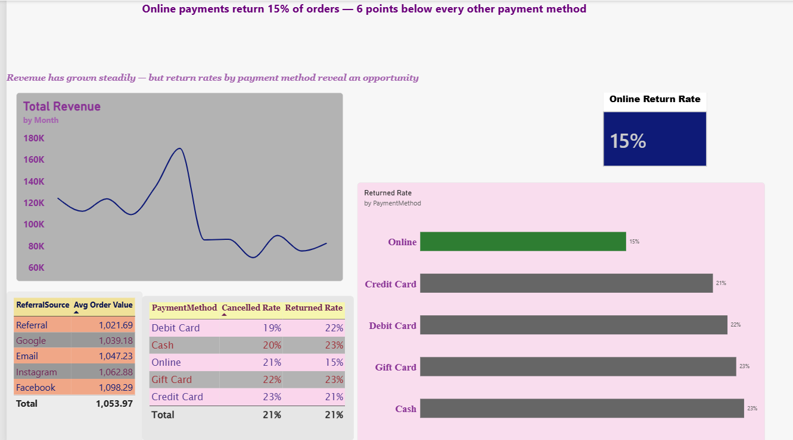

# Payment Method & Returns Analysis: Data Visualization Dashboard

**Project 4: Data Visualization & Storytelling**
Built with Power BI (Power Query + DAX)



## Business Question

Which payment methods are associated with the lowest order return rates, and what should the business do about it?

## Key Insight

**Online payments show a 15% return rate, 6 to 8 points lower than every other payment method.**

| Payment Method | Returned Rate |
|---|---|
| Online | **15%** |
| Credit Card | 21% |
| Debit Card | 22% |
| Gift Card | 23% |
| Cash | 23% |
| *Overall average* | *21%* |

**Recommendation:** Test incentives that steer customers toward online checkout, then monitor whether overall return rates fall.

## Dataset

E-commerce orders dataset provided by DecodeLabs.

| Column | Description |
|---|---|
| OrderID, CustomerID | Order and customer identifiers |
| Date | Order date (stored as an Excel serial number in the source file) |
| Product, Quantity, UnitPrice, TotalPrice | What was ordered and its value |
| PaymentMethod | Cash, Credit Card, Debit Card, Gift Card, Online |
| OrderStatus | Shipped, Delivered, Pending, Returned, Cancelled |
| CouponCode, ReferralSource, ItemsInCart | Marketing and cart attributes |

## Process

### 1. Data cleaning (Power Query)
- Converted the `Date` column from Excel serial numbers to a proper Date type
- Replaced null `CouponCode` values with `"None"` using a custom column, so "no coupon used" reads as a real category
- Verified numeric types for `Quantity`, `UnitPrice`, `TotalPrice` and `ItemsInCart`

### 2. DAX measures
```DAX
Total Revenue = SUM(Sheet1[TotalPrice])
Avg Order Value = AVERAGE(Sheet1[TotalPrice])
Order Count = COUNTROWS(Sheet1)
Cancelled Rate = DIVIDE(CALCULATE(COUNTROWS(Sheet1), Sheet1[OrderStatus] = "Cancelled"), [Order Count])
Returned Rate = DIVIDE(CALCULATE(COUNTROWS(Sheet1), Sheet1[OrderStatus] = "Returned"), [Order Count])
Online Return Rate = CALCULATE([Returned Rate], Sheet1[PaymentMethod] = "Online")
```

### 3. Design approach
- **Insight first, chart second:** started from the business question, not from "what chart looks good"
- **Action title:** the headline states the conclusion rather than describing the chart
- **Spotlight color:** one accent color on the key bar, muted grey for everything else
- **Low chartjunk:** no gridlines, direct data labels instead of legends, zero-baseline bars
- **Narrative structure (SCR):** Situation (revenue trend), Complication (return rate gap), Resolution (recommendation)
- **KPI card top-left:** where the eye lands first

## Dashboard Components

1. **Action title:** the headline finding
2. **KPI card:** Online return rate (15%)
3. **Line chart:** monthly revenue trend (context)
4. **Bar chart:** returned rate by payment method, with Online highlighted

## Limitations

- Rates are calculated over **all** orders, including Pending and Shipped orders that have not yet had a chance to be returned. A follow-up using only completed orders would be more rigorous.
- This shows an association, not causation. Online customers may differ in other ways (product mix, customer type).
- The gaps are modest, and no statistical significance test was run.

## Repository Structure

```
├── README.md
├── ProjectX_Dashboard.pbix
├── Dashboard.pdf
├── screenshots/
│   └── dashboard.png
└── data/
    └── (dataset or sample, if sharing is permitted)
```

## Tools

Power BI Desktop · Power Query · DAX

## Author

**Riya**
B.Tech Computer Science, MAKAUT
[LinkedIn](#https://www.linkedin.com/in/riya-patra-95310b332) · [GitHub](#https://github.com/riya-patra)

*Project completed as part of the DecodeLabs Industrial Training Kit (Batch 2026).*